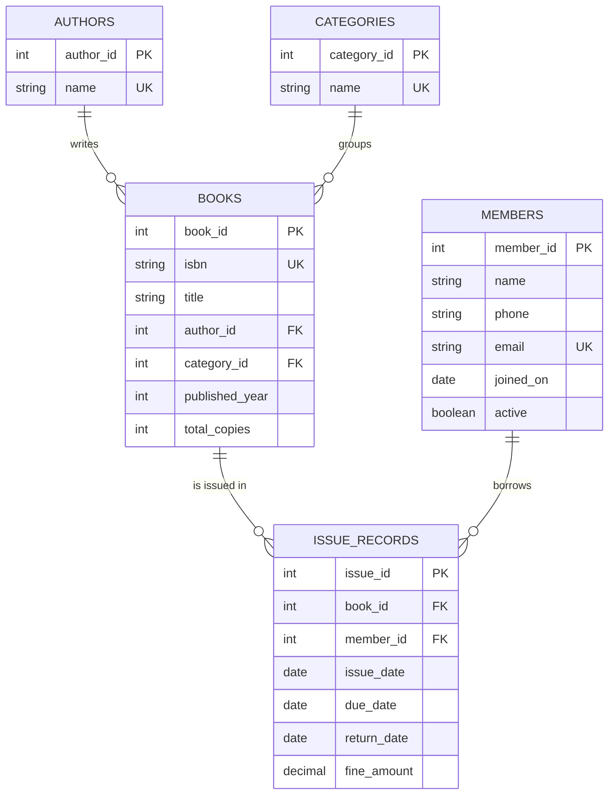

# Library Management System

A desktop application for running a small library: keep track of books and members, issue and return books, and calculate fines for late returns. It is written in **Java** with a **Swing** interface and stores everything in a **MySQL** database through **JDBC**.

## Features

- **Books** – add, edit and delete books; search by title, author, ISBN or category; see how many copies are available.
- **Members** – add, edit and delete members; search by member ID, name, phone or email; mark a member inactive instead of deleting them.
- **Issue & Return** – issue a book by typing a member ID and a book ID, return it with one click, and filter the records by status (on loan, overdue, returned) or by member ID.
- **Fines** – a late return is charged a fixed fine for every day after the due date; the fine is shown before the book is taken back and stored with the record.
- **Dashboard** – totals at a glance (titles, copies available, active members, books on loan, overdue books, fines collected) and a list of overdue books with the fine owed so far.
- **First-run set-up** – if the app cannot connect to MySQL it asks for the details in a window, creates its database and tables, fills them with sample data and remembers the settings.

## Library rules

| Rule | Default | Where to change it |
| --- | --- | --- |
| Loan period | 14 days | `loan.days` |
| Fine for a late book | ₹2 per day | `fine.per.day` |
| Books a member can have at once | 3 | `max.books.per.member` |

A book cannot be issued if no copy is free, if the member already has a copy of it, if the member is inactive, or if the member is at the limit. A book cannot be returned twice. A book or member that has issue records cannot be deleted, so the history is never lost.

## Tech stack

- Java 17+ (tested with Java 21), Swing
- MySQL 8+ and JDBC (`mysql-connector-j`)
- Gradle (the included wrapper downloads it, so nothing else needs installing)

## Database design

The schema is in third normal form: authors and categories are stored once and referenced by ID, and every link is a foreign key. A book does not store a count of free copies: that number is worked out from the issue records that have not been returned, so it can never get out of step.



Two people using the app at the same time cannot both take the last copy: issuing a book runs in a transaction that locks the book row first (`SELECT ... FOR UPDATE`).

## How the code is organised

```
src/main/java/library/
├── App.java            starts the program, connects to MySQL
├── config/             settings (library.properties)
├── db/                 connection, transactions, table definitions, sample data
├── model/              plain data objects (records)
├── dao/                all SQL, one class per table (plain JDBC, PreparedStatement everywhere)
├── service/            the library rules: issue, return, fines, validation
└── ui/                 Swing screens and pop-up forms
src/test/java/library/SelfTest.java   automated checks
```

The screens never talk to the database directly: they call `LibraryService`, which applies the rules and uses the DAO classes.

## What you need

1. **Java 17 or newer** (JDK). Check with `java -version`. Free download: <https://adoptium.net>
2. **MySQL Server 8 or newer**, running. Free download: <https://dev.mysql.com/downloads/mysql/> (on a Mac with Homebrew: `brew install mysql` then `brew services start mysql`)

## Run it

Open a terminal in this folder and run:

```
./gradlew run          (macOS / Linux)
gradlew.bat run        (Windows)
```

The first run downloads Gradle and the MySQL driver, so it needs an internet connection and takes a minute. After that it starts straight away.

- If MySQL asks for a password the app does not know yet, a **Connect to MySQL** window appears. Type your MySQL user name and password; they are saved to `library.properties` (which is not uploaded to GitHub).
- On the very first start the app creates a database called `library_db` and fills it with 15 books, 7 members and a few issue records (including two overdue books), so there is something to look at.
- macOS / Linux: if you see "permission denied", run `chmod +x gradlew` once, or use `sh gradlew run`.

### Settings

You do not have to create this file, but you can copy `library.properties.example` to `library.properties` and edit it:

| Setting | Meaning | Default |
| --- | --- | --- |
| `db.host`, `db.port` | where MySQL is running | `localhost`, `3306` |
| `db.name` | database to use (created if missing) | `library_db` |
| `db.user`, `db.password` | MySQL login | `root`, empty |
| `loan.days` | days a book can be kept | `14` |
| `fine.per.day` | fine for each late day | `2` |
| `max.books.per.member` | books one member can hold | `3` |
| `currency` | symbol shown before money | `₹` |

## Tests

```
./gradlew selfTest
```

This runs about 90 automated checks against a temporary MySQL database called `library_selftest` (created and deleted by the test itself). They cover the fine calculation, searching, form validation, every issue and return rule, deleting records that have history, accents and other languages in book titles, and two people trying to take the last copy at the same moment.

## Licence note

The MySQL driver (`mysql-connector-j`) is downloaded by Gradle when you run the app. It is not included in this repository.
